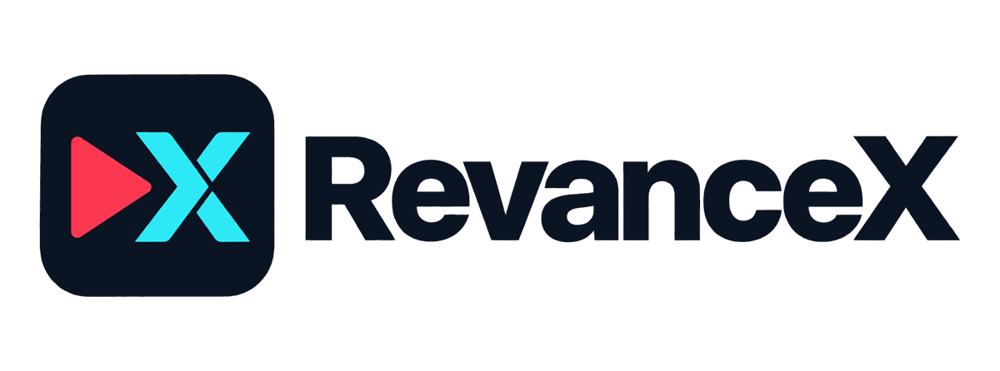

<p align="center">
  
</p>

# Revancex

[](https://t.me/revancex)
[](LICENSE)

Automated Android APK patcher and module orchestrator written in Rust. Revancex fetches stock APKs, applies upstream ReVanced/Morphe patches, and packages standalone signed APKs as well as Magisk, KernelSU, and APatch modules with an embedded WebUI.

## Highlights

- **31 Pre-Configured Apps**: YouTube, YouTube Music, Reddit, MicroG, TikTok, Instagram, Facebook, Threads, X Piko, Pinterest, Gboard, Google Maps, Proton VPN, AdGuard, Lightroom, CapCut, Termius, and more.
- **Fast Rust CLI (`revancex`)**: Single prebuilt binary with minimal runtime requirements (Java JDK 17+ for patching; Rust 1.85+ if building from source).
- **Resilient APK Sourcing**: Multi-source fallback pipeline (GitHub, GitLab, Archive.org, Codeberg, apkeep, APKPure, APKMirror, Uptodown, Aptoide, APKFab, APKCombo) with integrity, signature, and patch-compatibility checks.
- **Root & Non-Root Output**: Build standalone signed APKs, single-app root modules, or categorized multi-app bundles.
- **Embedded WebUI**: Root modules include a Material 3 Expressive WebUI for inspecting and toggling mounted apps in KernelSU, APatch, and Magisk.
- **Built-in Diagnostics & CI**: Environment checks (`doctor`), static/ADB smoke tests (`test`), YAML/patch validation (`validate`), and automated GitHub Actions builds.

---

## Downloads & Supported Apps

Browse apps visually on the [Web Catalogue](https://thunderkex.github.io/revancex/), get release alerts on [Telegram](https://t.me/revancex), or download the latest builds below. App definitions live in [`config/apps.yaml`](config/apps.yaml).

<!-- AUTO-APP-LIST-START -->

### Patched Apps & Single Root Modules

| App | Patched APK | Single Root Module | Last Updated |
| :--- | :--- | :--- | :--- |
| **AdGuard** | [AdGuard-4.14.68.apk](https://github.com/thunderkex/revancex/releases/download/auto-v1.1.0-2026.11.13-b178/AdGuard-4.14.68.apk) | - | 2026-11-13T08:23:36Z |
| **CamScanner** | [CamScanner-7.24.5.2608200000.apk](https://github.com/thunderkex/revancex/releases/download/auto-v1.1.0-2026.11.13-b178/CamScanner-7.24.5.2608200000.apk) | - | 2026-11-13T08:23:36Z |
| **CapCut** | [CapCut-19.9.0.apk](https://github.com/thunderkex/revancex/releases/download/auto-v1.1.0-2026.11.13-b178/CapCut-19.9.0.apk) | - | 2026-11-13T08:23:36Z |
| **Cloudflare WARP** | [Cloudflare-WARP-6.38.11.apk](https://github.com/thunderkex/revancex/releases/download/auto-v1.1.0-2026.11.13-b178/Cloudflare-WARP-6.38.11.apk) | - | 2026-11-13T08:23:36Z |
| **DramaBox** | [drama_box-patched.apk](https://github.com/thunderkex/revancex/releases/download/auto-v1.0.5-2026.09.28-b84/drama_box-patched.apk) | - | 2026-09-28 08:40:43 UTC |
| **Duolingo** | [Duolingo-6.98.4.apk](https://github.com/thunderkex/revancex/releases/download/auto-v1.1.0-2026.11.13-b178/Duolingo-6.98.4.apk) | - | 2026-11-13T08:23:36Z |
| **Facebook** | [Facebook-586.0.0.52.53.apk](https://github.com/thunderkex/revancex/releases/download/auto-v1.1.0-2026.11.13-b178/Facebook-586.0.0.52.53.apk) | - | 2026-11-13T08:23:36Z |
| **Flightradar24** | [Flightradar24-11.13.0.apk](https://github.com/thunderkex/revancex/releases/download/auto-v1.1.0-2026.11.13-b178/Flightradar24-11.13.0.apk) | - | 2026-11-13T08:23:36Z |
| **Gboard** | [Gboard-18.5.4.993608717-release-arm64-v8a.apk](https://github.com/thunderkex/revancex/releases/download/auto-v1.1.0-2026.11.13-b178/Gboard-18.5.4.993608717-release-arm64-v8a.apk) | - | 2026-11-13T08:23:36Z |
| **Google Maps** | [Google-Maps-26.36.04.973607363.apk](https://github.com/thunderkex/revancex/releases/download/auto-v1.1.0-2026.11.13-b178/Google-Maps-26.36.04.973607363.apk) | - | 2026-11-13T08:23:36Z |
| **Hungry Shark Evolution** | [Hungry-Shark-Evolution-14.5.0.apk](https://github.com/thunderkex/revancex/releases/download/auto-v1.1.0-2026.11.13-b178/Hungry-Shark-Evolution-14.5.0.apk) | - | 2026-11-13T08:23:36Z |
| **Instagram** | [Instagram-453.0.0.57.79.apk](https://github.com/thunderkex/revancex/releases/download/auto-v1.1.0-2026.11.11-b174/Instagram-453.0.0.57.79.apk) | - | 2026-11-11T09:29:12Z |
| **Lightroom** | [Lightroom-11.5.31.apk](https://github.com/thunderkex/revancex/releases/download/auto-v1.1.0-2026.11.13-b178/Lightroom-11.5.31.apk) | - | 2026-11-13T08:23:36Z |
| **MicroG** | [microg.apk](https://github.com/thunderkex/revancex/releases/download/auto-v1.1.0-2026.11.13-b178/microg.apk) | - | 2026-11-13T08:23:36Z |
| **Moviebox** | [Moviebox-4.0.03.1020.03.apk](https://github.com/thunderkex/revancex/releases/download/auto-v1.1.0-2026.11.13-b178/Moviebox-4.0.03.1020.03.apk) | - | 2026-11-13T08:23:36Z |
| **MX Player** | [MX-Player-3.5.2.apk](https://github.com/thunderkex/revancex/releases/download/auto-v1.1.0-2026.11.13-b178/MX-Player-3.5.2.apk) | - | 2026-11-13T08:23:36Z |
| **Pinterest** | [Pinterest-14.23.0.apk](https://github.com/thunderkex/revancex/releases/download/auto-v1.1.0-2026.11.13-b178/Pinterest-14.23.0.apk) | - | 2026-11-13T08:23:36Z |
| **Pixiv** | [Pixiv-6.196.0.apk](https://github.com/thunderkex/revancex/releases/download/auto-v1.1.0-2026.11.13-b178/Pixiv-6.196.0.apk) | - | 2026-11-13T08:23:36Z |
| **Proton VPN** | [Proton-VPN-5.21.9.0.apk](https://github.com/thunderkex/revancex/releases/download/auto-v1.1.0-2026.11.13-b178/Proton-VPN-5.21.9.0.apk) | - | 2026-11-13T08:23:36Z |
| **Plants vs Zombies** | [Plants-vs-Zombies-3.18.0.apk](https://github.com/thunderkex/revancex/releases/download/auto-v1.1.0-2026.11.13-b178/Plants-vs-Zombies-3.18.0.apk) | - | 2026-11-13T08:23:36Z |
| **Reddit** | [Reddit-2026.42.0.apk](https://github.com/thunderkex/revancex/releases/download/auto-v1.1.0-2026.11.13-b178/Reddit-2026.42.0.apk) | - | 2026-11-13T08:23:36Z |
| **Termius** | [Termius-7.11.2.apk](https://github.com/thunderkex/revancex/releases/download/auto-v1.1.0-2026.11.13-b178/Termius-7.11.2.apk) | - | 2026-11-13T08:23:36Z |
| **Stellarium** | [Stellarium-1.16.3.apk](https://github.com/thunderkex/revancex/releases/download/auto-v1.1.0-2026.11.13-b178/Stellarium-1.16.3.apk) | - | 2026-11-13T08:23:36Z |
| **Sticker Maker** | [Sticker-Maker-1.0.12-7.apk](https://github.com/thunderkex/revancex/releases/download/auto-v1.1.0-2026.11.13-b178/Sticker-Maker-1.0.12-7.apk) | - | 2026-11-13T08:23:36Z |
| **Strava** | [Strava-486.11.apk](https://github.com/thunderkex/revancex/releases/download/auto-v1.1.0-2026.11.13-b178/Strava-486.11.apk) | - | 2026-11-13T08:23:36Z |
| **Threads** | [Threads-454.0.0.54.79.apk](https://github.com/thunderkex/revancex/releases/download/auto-v1.1.0-2026.11.13-b178/Threads-454.0.0.54.79.apk) | - | 2026-11-13T08:23:36Z |
| **TikTok** | [TikTok-47.7.3.apk](https://github.com/thunderkex/revancex/releases/download/auto-v1.1.0-2026.11.13-b178/TikTok-47.7.3.apk) | - | 2026-11-13T08:23:36Z |
| **WPS Office** | [WPS-Office-18.24.apk](https://github.com/thunderkex/revancex/releases/download/auto-v1.1.0-2026.11.13-b178/WPS-Office-18.24.apk) | - | 2026-11-13T08:23:36Z |
| **X Piko** | [X-Piko-12.41.0-prod.01.apk](https://github.com/thunderkex/revancex/releases/download/auto-v1.1.0-2026.11.13-b178/X-Piko-12.41.0-prod.01.apk) | - | 2026-11-13T08:23:36Z |
| **YouTube** | [YouTube-21.13.164.apk](https://github.com/thunderkex/revancex/releases/download/auto-v1.1.0-2026.11.13-b178/YouTube-21.13.164.apk) | [YouTube-21.13.164-module.zip](https://github.com/thunderkex/revancex/releases/download/auto-v1.1.0-2026.11.13-b178/YouTube-21.13.164-module.zip) | 2026-11-13T08:23:36Z |
| **YouTube Music** | [YouTube-Music-9.15.51.apk](https://github.com/thunderkex/revancex/releases/download/auto-v1.1.0-2026.11.13-b178/YouTube-Music-9.15.51.apk) | [YouTube-Music-9.15.51-module.zip](https://github.com/thunderkex/revancex/releases/download/auto-v1.1.0-2026.11.13-b178/YouTube-Music-9.15.51-module.zip) | 2026-11-13T08:23:36Z |


### Bundle Modules (Multi-App)

| Bundle Name | Included Apps & Payload Files | Download Link | Release Tag | Updated At |
| :--- | :--- | :--- | :--- | :--- |
| **All Bundle**<br><code>revancex-bundle-all.zip</code> | <details><summary><b>30 Apps / APKs (Click to view)</b></summary><ul><li><b>AdGuard</b>: <code>apks/adguard.apk</code></li><li><b>CamScanner</b>: <code>apks/camscanner.apk</code></li><li><b>CapCut</b>: <code>apks/capcut.apk</code></li><li><b>Cloudflare WARP</b>: <code>apks/cloudflare_warp.apk</code></li><li><b>DramaBox</b>: <code>apks/drama_box.apk</code></li><li><b>Duolingo</b>: <code>apks/duolingo.apk</code></li><li><b>Facebook</b>: <code>apks/facebook.apk</code></li><li><b>Flightradar24</b>: <code>apks/flightradar24.apk</code></li><li><b>Gboard</b>: <code>apks/gboard.apk</code></li><li><b>Google Maps</b>: <code>apks/google_maps.apk</code></li><li><b>Hungry Shark Evolution</b>: <code>apks/hungry_shark_evolution.apk</code></li><li><b>Instagram</b>: <code>apks/instagram.apk</code></li><li><b>Lightroom</b>: <code>apks/lightroom.apk</code></li><li><b>Moviebox</b>: <code>apks/moviebox.apk</code></li><li><b>MX Player</b>: <code>apks/mx_player.apk</code></li><li><b>Pinterest</b>: <code>apks/pinterest.apk</code></li><li><b>Pixiv</b>: <code>apks/pixiv.apk</code></li><li><b>Proton VPN</b>: <code>apks/proton_vpn.apk</code></li><li><b>Plants vs Zombies</b>: <code>apks/pvz_free.apk</code></li><li><b>Reddit</b>: <code>apks/reddit.apk</code></li><li><b>Termius</b>: <code>apks/serverauditor.apk</code></li><li><b>Stellarium</b>: <code>apks/stellarium.apk</code></li><li><b>Sticker Maker</b>: <code>apks/sticker_maker.apk</code></li><li><b>Strava</b>: <code>apks/strava.apk</code></li><li><b>Threads</b>: <code>apks/threads.apk</code></li><li><b>TikTok</b>: <code>apks/tiktok.apk</code></li><li><b>WPS Office</b>: <code>apks/wps_office.apk</code></li><li><b>X Piko</b>: <code>apks/x_piko.apk</code></li><li><b>YouTube</b>: <code>apks/youtube.apk</code></li><li><b>YouTube Music</b>: <code>apks/youtube_music.apk</code></li></ul></details> | [Download Zip](https://github.com/thunderkex/revancex/releases/download/auto-v1.1.0-2026.11.13-b176/revancex-bundle-all.zip) | `auto-v1.1.0-2026.11.13-b176` | 2026-11-13T03:07:45Z |
| **Core Essentials Bundle**<br><code>revancex-bundle-core.zip</code> | <details><summary><b>4 Apps / APKs (Click to view)</b></summary><ul><li><b>YouTube</b>: <code>apks/youtube.apk</code></li><li><b>YouTube Music</b>: <code>apks/youtube_music.apk</code></li><li><b>Reddit</b>: <code>apks/reddit.apk</code></li><li><b>X Piko</b>: <code>apks/x_piko.apk</code></li></ul></details> | [Download Zip](https://github.com/thunderkex/revancex/releases/download/auto-v1.1.0-2026.11.13-b178/revancex-bundle-core.zip) | `auto-v1.1.0-2026.11.13-b178` | 2026-11-13T08:23:36Z |
| **Multimedia Bundle**<br><code>revancex-bundle-multimedia.zip</code> | <details><summary><b>2 Apps / APKs (Click to view)</b></summary><ul><li><b>YouTube</b>: <code>apks/youtube.apk</code></li><li><b>YouTube Music</b>: <code>apks/youtube_music.apk</code></li></ul></details> | [Download Zip](https://github.com/thunderkex/revancex/releases/download/auto-v1.1.0-2026.11.13-b178/revancex-bundle-multimedia.zip) | `auto-v1.1.0-2026.11.13-b178` | 2026-11-13T08:23:36Z |
| **Productivity Bundle**<br><code>revancex-bundle-productivity.zip</code> | <details><summary><b>3 Apps / APKs (Click to view)</b></summary><ul><li><b>CamScanner</b>: <code>apks/camscanner.apk</code></li><li><b>Lightroom</b>: <code>apks/lightroom.apk</code></li><li><b>WPS Office</b>: <code>apks/wps_office.apk</code></li></ul></details> | [Download Zip](https://github.com/thunderkex/revancex/releases/download/auto-v1.1.0-2026.11.13-b178/revancex-bundle-productivity.zip) | `auto-v1.1.0-2026.11.13-b178` | 2026-11-13T08:23:36Z |
| **Social Bundle**<br><code>revancex-bundle-social.zip</code> | <details><summary><b>7 Apps / APKs (Click to view)</b></summary><ul><li><b>Reddit</b>: <code>apks/reddit.apk</code></li><li><b>TikTok</b>: <code>apks/tiktok.apk</code></li><li><b>Instagram</b>: <code>apks/instagram.apk</code></li><li><b>Facebook</b>: <code>apks/facebook.apk</code></li><li><b>Threads</b>: <code>apks/threads.apk</code></li><li><b>X Piko</b>: <code>apks/x_piko.apk</code></li><li><b>Pixiv</b>: <code>apks/pixiv.apk</code></li></ul></details> | [Download Zip](https://github.com/thunderkex/revancex/releases/download/auto-v1.1.0-2026.11.13-b178/revancex-bundle-social.zip) | `auto-v1.1.0-2026.11.13-b178` | 2026-11-13T08:23:36Z |
| **Tools Bundle**<br><code>revancex-bundle-tools.zip</code> | <details><summary><b>2 Apps / APKs (Click to view)</b></summary><ul><li><b>AdGuard</b>: <code>apks/adguard.apk</code></li><li><b>Proton VPN</b>: <code>apks/proton_vpn.apk</code></li></ul></details> | [Download Zip](https://github.com/thunderkex/revancex/releases/download/auto-v1.1.0-2026.11.13-b178/revancex-bundle-tools.zip) | `auto-v1.1.0-2026.11.13-b178` | 2026-11-13T08:23:36Z |


### Custom Bundle Modules

| Custom Bundle | Download Link | Release Tag | Updated At |
| :--- | :--- | :--- | :--- |
| _None yet_ | - | - | - |

<!-- AUTO-APP-LIST-END -->

---

## Quick Start (CLI)

**Prerequisites**: Java JDK 17+ (JDK 21 recommended).

1. **Get the CLI** from [GitHub Releases](https://github.com/thunderkex/revancex/releases) ([Linux x86_64](https://github.com/thunderkex/revancex/releases/latest/download/revancex-linux-x86_64.tar.gz) / [Windows x86_64](https://github.com/thunderkex/revancex/releases/latest/download/revancex-windows-x86_64.zip)), or build from source with Rust 1.85+:

   ```bash
   cargo build --release
   ```

2. **Verify environment & fetch patcher tools**:

   ```bash
   ./revancex doctor
   ./revancex download-tools
   ```

3. **Build patched APKs**:

   ```bash
   # Build specific apps (architectures: arm64-v8a, armeabi-v7a, x86_64, all)
   ./revancex build --apps youtube,microg --arch arm64-v8a

   # Build all apps and keep going on individual failures
   ./revancex build --apps all --arch arm64-v8a --keep-going
   ```

   Build modes (`--mode`): `full` (default), `lite` (strips unused ABIs/resources), `both` (APK + root payload), `root` / `module`, or `install` (re-sign without patching).

4. **Package root modules & smoke test (optional)**:

   ```bash
   # Single-app or categorized bundle module (core, social, multimedia, productivity, tools, all)
   ./revancex module --single --apps youtube --output ./modules
   ./revancex module --bundle --apps core --output ./modules

   # Static DEX/Manifest or ADB device smoke test
   ./revancex test --apps all --fail-threshold 10 --continue
   ```

---

## Reference & Configuration

<details>
<summary><b>CLI Subcommands</b></summary>

Global flags: `-v, --verbose`, `-c, --config-dir <dir>` (default `./config`).

| Command | Description | Example |
| --- | --- | --- |
| `doctor` | Check Java, Android tools, bypass services, keystore, and config | `revancex doctor` |
| `apps` | List configured apps, status, and package IDs | `revancex apps [--json]` |
| `download-tools` | Download patcher JARs and patch bundles | `revancex download-tools [--apps youtube]` |
| `check-updates` | Poll upstream sources for app and patch updates | `revancex check-updates [--json]` |
| `build` | Fetch, verify, patch, sign APKs, and write `BUILD_REPORT.json` / `.md` | `revancex build --apps youtube --arch arm64-v8a` |
| `module` | Package APKs into single or bundle Magisk/KernelSU/APatch modules | `revancex module --bundle --apps core` |
| `test` | Run static DEX/manifest checks or ADB device smoke tests | `revancex test --apps all` |
| `validate` | Validate YAML configs, `modules.yaml` sync, and patch compatibility | `revancex validate [--strict] [--online]` |
| `clean` | Clear build cache (`--all` also clears `tools/`) or stale tools | `revancex clean [--all] [--stale-tools]` |
| `fetch-apk` | Download stock APK using the multi-source chain | `revancex fetch-apk youtube [--arch arm64-v8a]` |
| `verify-module` | Verify structure and integrity of a root module zip | `revancex verify-module ./modules/revancex-bundle-core.zip` |
| `patches` | List included, excluded, and auto-disabled patches for an app | `revancex patches youtube [--mode root\|nonroot]` |
| `keystore` | Inspect resolved signing keystore details | `revancex keystore --info` |
| `report` | Enforce failure thresholds on `BUILD_REPORT.json` in CI | `revancex report check ./output/BUILD_REPORT.json` |
| `sources` | Probe and benchmark configured APK sources | `revancex sources probe youtube` |
| `gen-apps-json` | Generate `docs/apps.json` from the release registry | `revancex gen-apps-json` |
| `generate-matrix` | Generate CI build matrix JSON for GitHub Actions | `revancex generate-matrix` |

</details>

<details>
<summary><b>Root Module Bundles</b></summary>

Each root module zip (`revancex-bundle-<category>.zip`) is compatible with Magisk, KernelSU, and APatch, and includes dynamic bind-mount scripts (`customize.sh`, `service.sh`, `action.sh`, `uninstall.sh`), `apks/`, and an optional embedded `webui/`.

<!-- AUTO-BUNDLE-BREAKDOWN-START -->
| Bundle | Zip File | Apps | Included Applications |
| :--- | :--- | :---: | :--- |
| **All** | `revancex-bundle-all.zip` | 30 | AdGuard, CamScanner, CapCut, Cloudflare WARP, DramaBox, Duolingo, Facebook, Flightradar24, Gboard, Google Maps, Hungry Shark Evolution, Instagram, Lightroom, Moviebox, MX Player, Pinterest, Pixiv, Proton VPN, Plants vs Zombies, Reddit, Termius, Stellarium, Sticker Maker, Strava, Threads, TikTok, WPS Office, X Piko, YouTube, YouTube Music |
| **Core Essentials** | `revancex-bundle-core.zip` | 4 | YouTube, YouTube Music, Reddit, X Piko |
| **Multimedia** | `revancex-bundle-multimedia.zip` | 2 | YouTube, YouTube Music |
| **Productivity** | `revancex-bundle-productivity.zip` | 3 | CamScanner, Lightroom, WPS Office |
| **Social** | `revancex-bundle-social.zip` | 7 | Reddit, TikTok, Instagram, Facebook, Threads, X Piko, Pixiv |
| **Tools** | `revancex-bundle-tools.zip` | 2 | AdGuard, Proton VPN |
<!-- AUTO-BUNDLE-BREAKDOWN-END -->

</details>

<details>
<summary><b>Configuration, Environment Variables & Adding Apps</b></summary>

- **YAML Config**: App, source, module, and build schemas are documented in [`CONFIG.md`](CONFIG.md).
- **Adding a New App**:
  1. Add an entry to [`config/apps.yaml`](config/apps.yaml).
  2. Check patches and validate: `./revancex patches <app_id>` and `./revancex validate --strict --apps <app_id>`.
  3. Build and test: `./revancex build --apps <app_id>` and `./revancex test --apps <app_id>`.
- **Environment Variables**: Copy `.env.example` to `.env` (never commit `.env`). Common variables:
  - **Tokens & Signing**: `GITHUB_TOKEN`, `GITLAB_TOKEN`, `KEYSTORE_PASSWORD`, `KEYSTORE_FILE`, `KEYSTORE_B64`
  - **Notifications**: `TG_TOKEN`, `TG_CHAT`, `TG_CHANNEL`, `TG_TOPIC`
  - **Bypass & Runtime**: `FLARESOLVERR_URL`, `FLARESOLVERR_ENABLED`, `TRAWL_URL`, `REVANCEX_STATIC_TEST`, `REVANCEX_APP_TIMEOUT_SECS`
  - **Paths & Logging**: `REVANCEX_CONFIG_DIR`, `REVANCEX_TEMP_DIR`, `REVANCEX_LOG_DIR`, `VERBOSE` / `RUST_LOG`, `NO_COLOR` / `REVANCEX_ASCII`

</details>

<details>
<summary><b>GitHub Actions (Automated Builds)</b></summary>

Fork or push to `extended` to run the automated pipelines:

- `check-updates.yml` — Polls upstream patch releases every 23 hours and triggers builds on changes.
- `auto-build.yml` / `build-and-release.yml` — Builds APKs and modules, runs smoke tests, and publishes GitHub Releases.
- `custom-build.yml` — Handles custom bundle requests from the Web Catalogue or `workflow_dispatch`.
- `update-pages.yml` — Syncs `config/releases_registry.json`, `README.md`, and `docs/apps.json`.
- `ci.yml` & `release-cli.yml` — Runs `cargo fmt`, `cargo clippy`, tests, and builds Linux/Windows CLI binaries.

</details>

<details>
<summary><b>Upstream Patch Sources</b></summary>

> Sourced dynamically from [`config/sources.yaml`](config/sources.yaml).

<!-- AUTO-PATCH-SOURCES-START -->
| ID | Repository | Asset Pattern |
| :--- | :--- | :--- |
| `anddea` | [anddea/revanced-patches](https://github.com/anddea/revanced-patches) | `*.mpp` |
| `de_revanced` | [RookieEnough/De-Vanced](https://github.com/RookieEnough/De-Vanced) | `*.mpp` |
| `piko` | [crimera/piko](https://github.com/crimera/piko) | `*.mpp` |
| `piko_ig_lite` | [crimera/piko-ig-lite](https://github.com/crimera/piko-ig-lite) | `*.mpp` |
| `piko_newx` | [crimera/piko-newx](https://github.com/crimera/piko-newx) | `*.mpp` |
| `morphe_patches` | [MorpheApp/morphe-patches](https://github.com/MorpheApp/morphe-patches) | `*.mpp` |
| `icysymmetra` | [icysymmetra/tiktok-patches-for-morphe](https://github.com/icysymmetra/tiktok-patches-for-morphe) | `*.mpp` |
| `hoodles` | [hoo-dles/morphe-patches](https://github.com/hoo-dles/morphe-patches) | `*.mpp` |
| `rushiranpise` | [rushiranpise/morphe-patches](https://github.com/rushiranpise/morphe-patches) | `*.mpp` |
| `durgesh` | [durgesh0505/chiggi_morphe_patches](https://github.com/durgesh0505/chiggi_morphe_patches) | `*.mpp` |
| `arandomhooman` | [arandomhooman/hoomans-morphe-patches](https://github.com/arandomhooman/hoomans-morphe-patches) | `*.mpp` |
| `hxreborn` | [hxreborn/morphe-patches](https://github.com/hxreborn/morphe-patches) | `*.mpp` |
| `bholey` | [BholeyKaBhakt/android-patches-xtra](https://github.com/BholeyKaBhakt/android-patches-xtra) | `*.mpp` |
| `jkennethcarino` | [jkennethcarino/adobo](https://github.com/jkennethcarino/adobo) | `*.mpp` |
| `sapitosucio` | [SapitoSucio/FroggoMorphePatches](https://github.com/SapitoSucio/FroggoMorphePatches) | `*.mpp` |
| `browzomje` | [browzomje/browzomje-patches](https://github.com/browzomje/browzomje-patches) | `*.mpp` |
| `blazeftl` | [BlazeFTL/FTL-Patches](https://github.com/BlazeFTL/FTL-Patches) | `*.mpp` |
| `byehi98` | [byehi98/okish-morphe-patches](https://github.com/byehi98/okish-morphe-patches) | `*.mpp` |
| `hushfeed` | [SysAdminDoc/HushFeed](https://github.com/SysAdminDoc/HushFeed) | `*.mpp` |
| `hushfacebook` | [SysAdminDoc/Hushfacebook](https://github.com/SysAdminDoc/Hushfacebook) | `*.mpp` |
| `hushthreads` | [SysAdminDoc/HushThreads](https://github.com/SysAdminDoc/HushThreads) | `*.mpp` |
| `legendsciber` | [legendsciber/morphe-patches](https://github.com/legendsciber/morphe-patches) | `*.mpp` |
| `bearinmindcat` | [bearinmindcat/morphe-patches](https://github.com/bearinmindcat/morphe-patches) | `*.mpp` |
| `jasonwu` | [jasonwu1994/Gboard-patches](https://github.com/jasonwu1994/Gboard-patches) | `*.mpp` |
| `kveld9` | [kveld9/kveld-extra-morphe-patches](https://github.com/kveld9/kveld-extra-morphe-patches) | `*.mpp` |
| `frip` | [Fripe070/PixivPatches](https://github.com/Fripe070/PixivPatches) | `*.mpp` |
| `madush` | [madushas/morphe-patches-custom](https://github.com/madushas/morphe-patches-custom) | `*.mpp` |
<!-- AUTO-PATCH-SOURCES-END -->

</details>

---

## License

Revancex is licensed under the [GNU General Public License v3.0](LICENSE).
